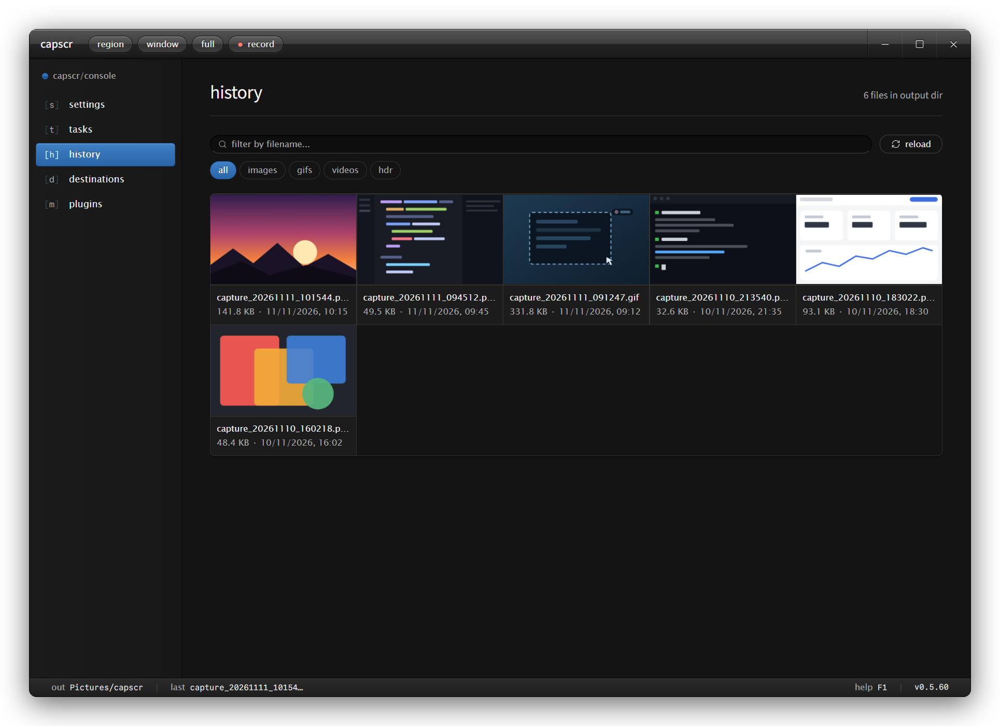
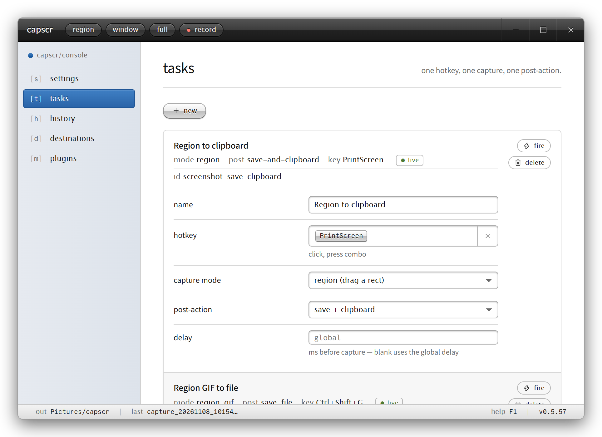

# capscr

A tray screen capture tool for Windows and Linux: screenshots, GIF and MP4 recording, HDR support, signed updates, no telemetry.





[homepage](https://rot.lt/work/capscr) · [plugins](https://rot.lt/work/capscr/plugins) · [downloads](https://github.com/zeo/capscr/releases/latest)

## features

- tasks: each hotkey pairs a capture mode (region, last region, window, fullscreen, active monitor, GIF, MP4) with an action (save, copy, editor, annotate, upload, OCR). Defaults: region to save and copy (bound on first launch), `Ctrl+Shift+G` for GIF, `Ctrl+Shift+V` for MP4. Any task also runs from `capscr --task=<id>`, the Windows jump list or the GNOME panel menu; `capscr --list-tasks` prints the ids.
- selection: drag a region, click a window or press Enter for the full screen. `Alt+click` copies a pixel's hex color.
- editor: arrows, lines, boxes, ellipses, text, step numbers, freehand, highlighter and pixelate. Shapes stay editable after drawing: move them, drag their handles, change color or size. Crop, rotate and flip share one undo history; zoom from 25% to 800% or fit the window. Saving keeps the editor open.
- recording: on Windows the region stays as a frame you can move, resize or snap to a preset size while recording, with pause and stop on a toolbar that stays out of the output. Linux gets the toolbar without the frame. GIF size and quality are adjustable; MP4 can use NVENC, Quick Sync or AMF, and can carry system audio, a microphone narration track, or both mixed. History trims GIF and MP4 recordings and turns an MP4 clip into a GIF.
- HDR (Windows): tonemapped to SDR, or saved as HDR PNG. Linux compositors don't expose HDR pixels yet.
- uploads: Imgur, custom HTTPS, SFTP (Ed25519 and ECDSA keys), S3 or a plugin. Passwords live in the system credential store. History remembers each capture's upload link, and Imgur, SFTP and S3 uploads can be deleted from the host there.

## install

From the [releases page](https://github.com/zeo/capscr/releases/latest):

| file | for |
|---|---|
| `*-online-setup.exe`, `*-offline-setup.exe` | Windows 10 1903+ |
| `*-linux-x86_64-setup`, `*-linux-x86_64-offline-setup` | Linux installer |
| `.deb`, `.rpm` | Debian, Ubuntu, Mint; Fedora, openSUSE |
| `.AppImage` | any distro with glibc 2.39+ |

Linux needs webkit2gtk 4.1. MP4 uses `ffmpeg` (downloaded automatically on Windows), OCR uses `tesseract`. X11 and Wayland both work, with these differences:

| | X11 | KDE | wlroots | GNOME |
|---|---|---|---|---|
| window picking | capscr | KWin picker | capscr | portal picker |
| global hotkeys | yes | yes | portal or Advanced input | yes |
| mouse button hotkeys | Advanced input | Advanced input | Advanced input | Advanced input |
| tray icon | yes | yes | depends on host | needs AppIndicator |

Advanced input reads `/dev/input` and needs the `input` group. More in [`docs/platform-limits.md`](docs/platform-limits.md).

Settings live in `%APPDATA%\capscr\capscr\config\config.toml` or `~/.config/capscr/config.toml`.

## build from source

Rust 1.97+, Node 22.12+, MSVC build tools on Windows or the webkit2gtk stack on Linux.

```sh
git clone https://github.com/zeo/capscr.git
cd capscr
npm --prefix frontend ci
cargo install tauri-cli --version "^2" --locked
cargo tauri build
```

Debian/Ubuntu build dependencies:

```sh
sudo apt install build-essential curl wget file pkg-config libssl-dev \
  libgtk-3-dev libwebkit2gtk-4.1-dev libayatana-appindicator3-dev \
  librsvg2-dev libxdo-dev libclang-dev libxcb1-dev libxcb-shm0-dev \
  libxcb-randr0-dev libxrandr-dev libdbus-1-dev libpipewire-0.3-dev \
  libwayland-dev libegl-dev libgbm-dev libdrm-dev
```

## plugins

WASM plugins install from the plugins tab and hook into captures, saves and uploads. See [`docs/plugin-runtime.md`](docs/plugin-runtime.md) and [`docs/marketplace.md`](docs/marketplace.md).

## credits

The HDR tonemap is ported from [SKIV](https://github.com/SpecialKO/SKIV) by Andon "Kaldaien" Coleman (MIT), with MaxCLL logic adapted from GotoFinal's HDR tonemap reference (MIT).

## license

MIT, see [LICENSE](LICENSE).
